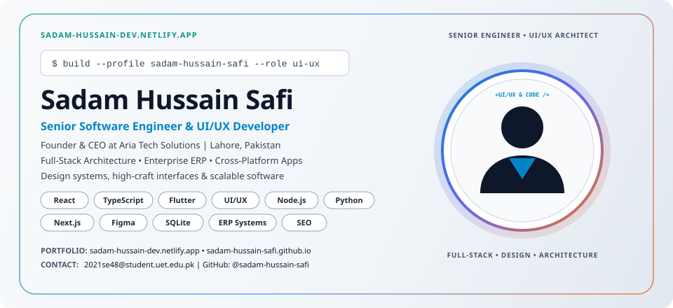



  

 

## About

I'm **Sadam Hussain Safi**, a **Senior Software Engineer, UI/UX Developer**, and **Founder & CEO at Aria Tech Solutions**. I build visually polished, user-focused web, desktop, and mobile applications with clean design systems, clear navigation, and scalable full-stack architectures.

- **Portfolio:** [sadam-hussain-dev.netlify.app](https://sadam-hussain-dev.netlify.app)
- **Developer Hub:** [sadam-hussain-safi.github.io](https://sadam-hussain-safi.github.io)
- **Email:** 2021se48@student.uet.edu.pk

---

## Core Engineering & UI/UX Tech Stack

| Domain | Technologies & Tools |
| :--- | :--- |
| **Frontend & UI/UX Design** | React, Next.js, TypeScript, JavaScript (ES6+), HTML5, CSS3, Responsive Grid Systems, Figma, SEO Optimization |
| **Cross-Platform & Mobile** | Flutter, Dart, Material Design Systems, Bilingual Localization (English / Pashto) |
| **Backend & Databases** | Node.js, Express, Python, Java, REST APIs, SQLite / FTS5, Modular Data Access Architecture |
| **AI & Natural Language Processing** | Sentence-Transformers, Seq2Seq & Attention Models, Machine Translation, AI Support Agents |
| **DevOps & Workflow** | Git, GitHub Actions, PowerShell Automation, VS Code, Cursor AI |

---

## Previous Experience & Multi-Disciplinary Skills

- **Enterprise ERP & Retail Systems Architecture:** Designed and engineered full-stack management platforms including the **WellCare Pharmacy Management System** (FEFO batch sorting engine, POS billing, RBAC, audit logging) and industrial manufacturing ERP workflows for raw material procurement and steel-supply order tracking.
- **Digital Retouching & Brand Poster Design:** Experienced in visual composition, editorial typography, portrait retouching, and retro-urban brand poster aesthetics—bringing strong graphic design sensibility into software UI/UX.
- **Medical & Legal Interpretation (Multilingual Communication):** Background as a freelance medical and legal interpreter, providing direct domain expertise in building accurate multilingual software and translation systems (Pashto / Dari / English).
- **Software Project Management & Algorithms:** Strong foundation in COCOMO II estimation, risk management, dynamic programming, and clean object-oriented database abstraction.

---

## GitHub Analytics & Activity

  
  

